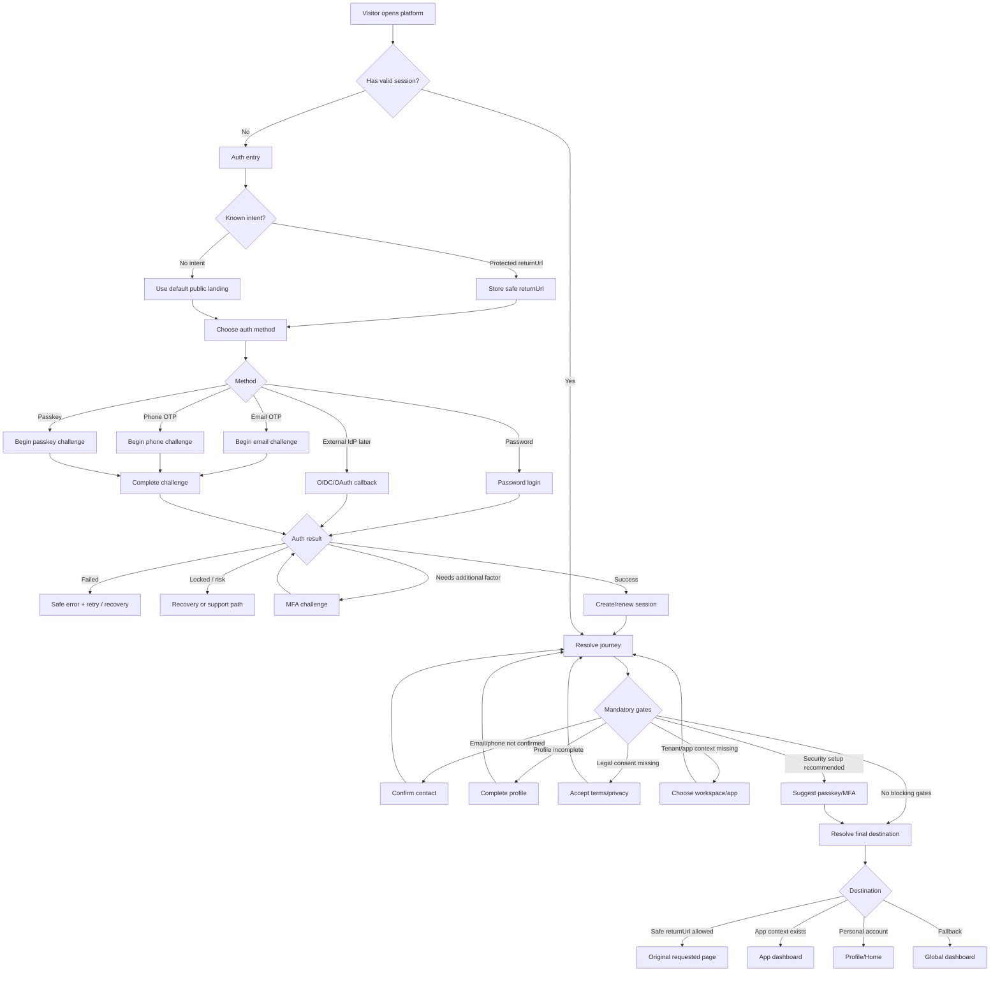

# ADR-0006: Standardize Platform Journey Routing

Date: 2026-06-29  
Status: Accepted  
App: Platform  
Module: Journey  
Capability: Post-authentication routing and onboarding flow  
Owner: Architecture  

## Context

The platform does not currently have one consistent journey after users enter the system.

A user may arrive from a protected page, authenticate, need to confirm or complete account information, and then continue to a profile, home, workspace, or dashboard. If each module or frontend page handles this independently, routing rules will become duplicated, inconsistent, and difficult to maintain.

Authentication already knows whether a user may require profile completion, but profile completion, consent, workspace selection, and final landing destination are not authentication responsibilities.

## Decision

Introduce a platform-wide **Journey** capability responsible for deciding the next valid destination for an authenticated user.

Authentication will authenticate the user and delegate post-authentication routing to Journey.

Frontend clients will follow the destination returned by Journey and must not duplicate journey priority rules.

## Journey Graph

## Journey Priority

Journey resolves destinations in this order:

1. Account recovery or disabled account (delegated to Authentication flow)
2. Suspicious login or required reauthentication (delegated to Authentication flow)
3. Required contact confirmation
4. Required profile completion
5. Required legal consent
6. Required workspace or app selection
7. Safe requested return URL
8. Last used app or workspace dashboard
9. User home
10. Global dashboard

The first blocking requirement wins.

## Route Policy

Mandatory completion routes must be explicit and purpose-specific.

Examples:

- `/account/profile/complete`
- `/account/contact/confirm`
- `/account/consents`
- `/workspaces/select`
- `/home`
- `/dashboard`

General settings pages must not be used as mandatory completion gates.

## Responsibility Boundaries

Authentication owns credential verification, challenge completion, session creation, and logout.

Users/Profile owns profile data and profile completion policy.

Journey owns post-authentication destination priority, blocking gate resolution, safe return URL handling, and fallback destination selection.

Frontend owns rendering pages and navigating to the backend-provided destination.

## Consequences

This creates one source of truth for post-login routing and prevents authentication, profile, workspace, and frontend code from each inventing their own redirect rules.

It also makes onboarding extensible without turning login handlers or frontend pages into routing decision engines.

The cost is one additional platform capability and a short migration period for existing authentication redirect contracts.

## Compliance

Implementation is compliant when:

- Authentication no longer hardcodes profile, settings, workspace, or dashboard destinations.
- Journey is the only owner of post-authentication destination priority.
- Profile completion rules are owned by Users/Profile.
- Frontend follows the resolved destination instead of inferring routing rules.
- Unsafe return URLs are rejected centrally.
- Mandatory profile completion uses `/account/profile/complete`, not a general settings route.
