# Journey Graph Visualizer

This page visualizes the complete journey map inventory under `docs/journeys/` as one Mermaid graph. It separates the implemented and current-state paths from planned future journeys, while showing how each journey hands off to the next focused flow.

## Legend

- **Green**: current-state journey documented as implemented or implemented behind a feature flag.
- **Teal**: current-state journey with documented gaps.
- **Blue**: future-state read/navigation journey.
- **Orange**: future-state state-changing journey.
- **Red**: future-state high-risk lifecycle journey.
- **Dashed links**: optional, conditional, or future handoffs.

## Complete Current and Future Journey Map

```mermaid
flowchart LR
    %% Entry and current-state setup
    Start([Authenticated user]):::entry
    Home[Home page<br/>Create Workspace CTA]:::current
    Onboarding[Owner onboarding<br/>Current-state setup flow<br/><code>owner-onboarding-journey.md</code>]:::current
    TenantCreated[(Owner + tenant + primary indicator<br/>active modules + roles)]:::state
    ModuleShortcuts[Home module dashboard shortcuts<br/>Sea / Medical / Commerce / Appointments]:::current

    %% Core future owner shell
    Dashboard[Owner dashboard<br/>Future command center<br/><code>owner-dashboard-journey.md</code>]:::futureRead
    Switcher[Owner tenant switcher<br/>Choose active tenant context<br/><code>owner-tenant-switcher-journey.md</code>]:::futureRead
    GlobalList[Global tenant list<br/>Read-only tenant directory<br/><code>owner-global-tenant-list-journey.md</code>]:::futureRead
    TenantOverview[Tenant overview<br/>Tenant-scoped command page<br/><code>owner-tenant-overview-journey.md</code>]:::futureRead
    ActionInbox[Action inbox<br/>Prioritized source-backed items<br/><code>owner-action-inbox-journey.md</code>]:::futureRead

    %% Focused future management journeys
    CreateTenant[Create tenant<br/>Existing-owner tenant creation<br/><code>owner-create-tenant-journey.md</code>]:::futureWrite
    MembersRoles[Members & roles<br/>Access review and role changes<br/><code>owner-members-roles-journey.md</code>]:::futureRead
    InviteRemove[Invite / remove users<br/>Focused access mutations<br/><code>owner-invite-remove-users-journey.md</code>]:::futureWrite
    TenantSettings[Tenant settings<br/>Safe editable fields<br/><code>owner-tenant-settings-journey.md</code>]:::futureWrite
    Billing[Billing<br/>Source-backed plan, invoice, payment actions<br/><code>owner-billing-page-journey.md</code>]:::futureRead
    AuditLog[Audit log<br/>Tenant-scoped activity review<br/><code>owner-audit-log-journey.md</code>]:::futureRead
    DangerZone[Danger zone<br/>Archive / restore / delete policy gates<br/><code>owner-danger-zone-journey.md</code>]:::futureRisk

    %% Medical module admin journeys
    MedicalDashboard[Medical dashboard / patient list]:::current
    PatientCrud[Patient profile CRUD<br/>Current-state profile management<br/><code>patient-profile-crud-journey.md</code>]:::current
    PatientCheckIn[Patient check-in<br/>Implemented guided reception flow<br/><code>patient-check-in-journey.md</code>]:::current
    PatientOverview[Patient overview<br/>Future consolidated patient command page<br/><code>patient-overview-journey.md</code>]:::futureRead
    PatientAppointments[Patient appointments<br/>Current state with scheduling gaps<br/><code>patient-appointment-journey.md</code>]:::currentGap
    PatientProcedures[Patient procedures<br/>Current state with clinical workflow gaps<br/><code>patient-procedure-journey.md</code>]:::currentGap

    %% Outcomes and shared data/query sources
    OwnerData[(Canonical owner / tenant data<br/>tenant identity, metadata, indicators, roles)]:::state
    FutureSources[(Future source-backed services<br/>actions, billing, audit, access read models)]:::state
    SafeEmpty([Honest unavailable / empty state]):::guardrail
    AuditEvents[(Audit events for sensitive actions)]:::state

    Start --> Home
    Home -->|feature flag enabled| Onboarding
    Onboarding --> TenantCreated
    TenantCreated --> OwnerData
    TenantCreated --> Home
    Home -->|tenant context resolved| ModuleShortcuts
    Home -. future owner entry .-> Dashboard
    ModuleShortcuts -->|Medical module| MedicalDashboard

    OwnerData --> Dashboard
    Dashboard --> Switcher
    Dashboard --> GlobalList
    Dashboard --> TenantOverview
    Dashboard --> ActionInbox
    Dashboard --> CreateTenant
    Dashboard --> MembersRoles
    Dashboard --> TenantSettings
    Dashboard --> Billing
    Dashboard --> AuditLog

    Switcher -->|confirm tenant| Dashboard
    Switcher -->|open directory| GlobalList
    GlobalList -->|open tenant| TenantOverview
    GlobalList -->|permitted empty/list CTA| CreateTenant
    CreateTenant -->|new tenant created| TenantOverview
    CreateTenant --> OwnerData

    TenantOverview --> Switcher
    TenantOverview --> MembersRoles
    TenantOverview --> TenantSettings
    TenantOverview --> Billing
    TenantOverview --> AuditLog
    TenantOverview --> ActionInbox
    TenantOverview -. policy-gated link .-> DangerZone

    ActionInbox -. invite/access item .-> MembersRoles
    ActionInbox -. billing item .-> Billing
    ActionInbox -. settings item .-> TenantSettings
    ActionInbox -. audit follow-up .-> AuditLog
    ActionInbox -. lifecycle item .-> DangerZone
    ActionInbox -->|no approved source| SafeEmpty

    MembersRoles -->|invite or remove action| InviteRemove
    MembersRoles -->|sensitive role changes| AuditEvents
    InviteRemove -->|access changed| MembersRoles
    InviteRemove --> AuditEvents

    TenantSettings -->|safe save| OwnerData
    TenantSettings -. risky setting .-> DangerZone
    TenantSettings --> AuditEvents

    Billing -. provider/internal action .-> AuditEvents
    Billing -->|no billing source| SafeEmpty
    AuditLog -->|follow affected record| MembersRoles
    AuditLog -. follow setting change .-> TenantSettings
    AuditLog -. follow billing event .-> Billing
    AuditLog -->|no audit source| SafeEmpty

    DangerZone -->|archive / restore / delete request| OwnerData
    DangerZone --> AuditEvents
    DangerZone -->|cancel / policy unavailable| TenantOverview

    FutureSources -. backs .-> ActionInbox
    FutureSources -. backs .-> Billing
    FutureSources -. backs .-> AuditLog
    FutureSources -. backs .-> MembersRoles
    FutureSources -. backs .-> InviteRemove

    MedicalDashboard --> PatientCrud
    MedicalDashboard --> PatientCheckIn
    MedicalDashboard -.-> PatientOverview
    PatientCrud -. open saved profile .-> PatientOverview
    PatientCrud -->|book for linked user| PatientAppointments
    PatientCheckIn -->|select or create profile| PatientCrud
    PatientCheckIn -->|current or future booking| PatientAppointments
    PatientCheckIn -. confirmation handoff .-> PatientOverview
    PatientOverview --> PatientCrud
    PatientOverview --> PatientAppointments
    PatientOverview --> PatientProcedures
    PatientAppointments -->|view patient context| PatientOverview
    PatientProcedures -->|record history / notes| PatientOverview
    PatientProcedures -. future provider/status/cancel gaps .-> SafeEmpty
    PatientAppointments -. future reschedule/provider/room gaps .-> SafeEmpty

    classDef entry fill:#f8fafc,stroke:#64748b,color:#0f172a,stroke-width:2px;
    classDef current fill:#dcfce7,stroke:#16a34a,color:#052e16,stroke-width:2px;
    classDef currentGap fill:#ccfbf1,stroke:#0f766e,color:#042f2e,stroke-width:2px;
    classDef futureRead fill:#dbeafe,stroke:#2563eb,color:#172554,stroke-width:2px;
    classDef futureWrite fill:#ffedd5,stroke:#f97316,color:#431407,stroke-width:2px;
    classDef futureRisk fill:#fee2e2,stroke:#dc2626,color:#450a0a,stroke-width:2px;
    classDef state fill:#f1f5f9,stroke:#475569,color:#0f172a,stroke-width:1px;
    classDef guardrail fill:#fef9c3,stroke:#ca8a04,color:#422006,stroke-width:2px;
```

## Reading the Map

1. The current platform setup journey is the self-service owner onboarding flow. It starts from the home page, creates the owner/tenant/indicator/module metadata/role assignments, and returns the user to the home experience.
2. The future owner dashboard becomes the hub above tenant and module dashboards. It should stay a navigation and summary surface, not a place for hidden state-changing logic.
3. Tenant overview is the future tenant-scoped command page. It links to focused journeys and keeps destructive work outside the overview itself.
4. Global tenant list and tenant switcher are read/navigation journeys that help users understand or change the active tenant context before taking tenant-scoped actions.
5. Members/roles, billing, audit, and action inbox are source-backed surfaces. Until their application contracts exist, they should render honest unavailable or empty states instead of fake counts or rows.
6. Create tenant, invite/remove users, tenant settings, and danger zone are future state-changing journeys. They should validate input, call focused use cases, and feed audit where sensitive changes occur.
7. Danger zone is intentionally isolated because archive, restore, and delete semantics require explicit policy gates and should not become ordinary settings-page buttons.
8. Medical module admin journeys branch from the Medical module shortcut/dashboard. Patient CRUD and check-in are current/implemented paths, while appointments and procedures are usable but carry documented scheduling and clinical workflow gaps.
9. Future medical patient overview should become the read-only patient command page that aggregates profile, appointments, procedures, flags, and quick actions without duplicating module-specific state.

## Source Journey Documents

- [docs/journeys/apps/clinic/owner/patient-appointment-journey.md](./apps/clinic/owner/patient-appointment-journey.md)
- [docs/journeys/apps/clinic/owner/patient-check-in-journey.md](./apps/clinic/owner/patient-check-in-journey.md)
- [docs/journeys/apps/clinic/owner/patient-overview-journey.md](./apps/clinic/owner/patient-overview-journey.md)
- [docs/journeys/apps/clinic/owner/patient-procedure-journey.md](./apps/clinic/owner/patient-procedure-journey.md)
- [docs/journeys/apps/clinic/owner/patient-profile-crud-journey.md](./apps/clinic/owner/patient-profile-crud-journey.md)
- [docs/journeys/platform/owners/owner-action-inbox-journey.md](./platform/owners/owner-action-inbox-journey.md)
- [docs/journeys/platform/owners/owner-audit-log-journey.md](./platform/owners/owner-audit-log-journey.md)
- [docs/journeys/platform/owners/owner-billing-page-journey.md](./platform/owners/owner-billing-page-journey.md)
- [docs/journeys/platform/owners/owner-create-tenant-journey.md](./platform/owners/owner-create-tenant-journey.md)
- [docs/journeys/platform/owners/owner-danger-zone-journey.md](./platform/owners/owner-danger-zone-journey.md)
- [docs/journeys/platform/owners/owner-dashboard-journey.md](./platform/owners/owner-dashboard-journey.md)
- [docs/journeys/platform/owners/owner-global-tenant-list-journey.md](./platform/owners/owner-global-tenant-list-journey.md)
- [docs/journeys/platform/owners/owner-invite-remove-users-journey.md](./platform/owners/owner-invite-remove-users-journey.md)
- [docs/journeys/platform/owners/owner-members-roles-journey.md](./platform/owners/owner-members-roles-journey.md)
- [docs/journeys/platform/owners/owner-onboarding-journey.md](./platform/owners/owner-onboarding-journey.md)
- [docs/journeys/platform/owners/owner-tenant-overview-journey.md](./platform/owners/owner-tenant-overview-journey.md)
- [docs/journeys/platform/owners/owner-tenant-settings-journey.md](./platform/owners/owner-tenant-settings-journey.md)
- [docs/journeys/platform/owners/owner-tenant-switcher-journey.md](./platform/owners/owner-tenant-switcher-journey.md)
