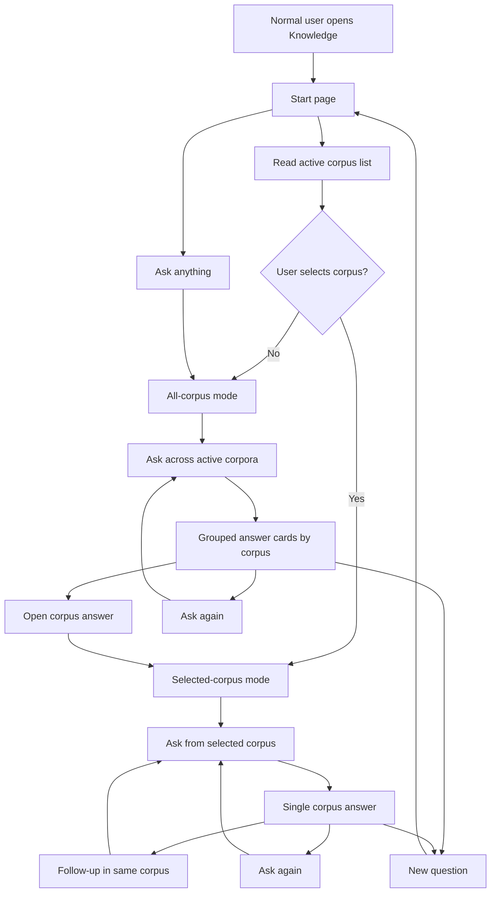
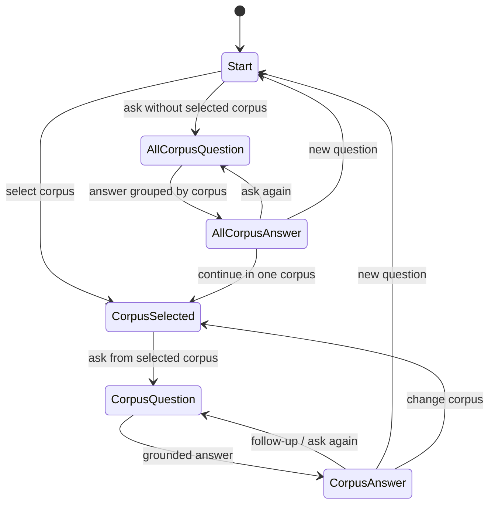
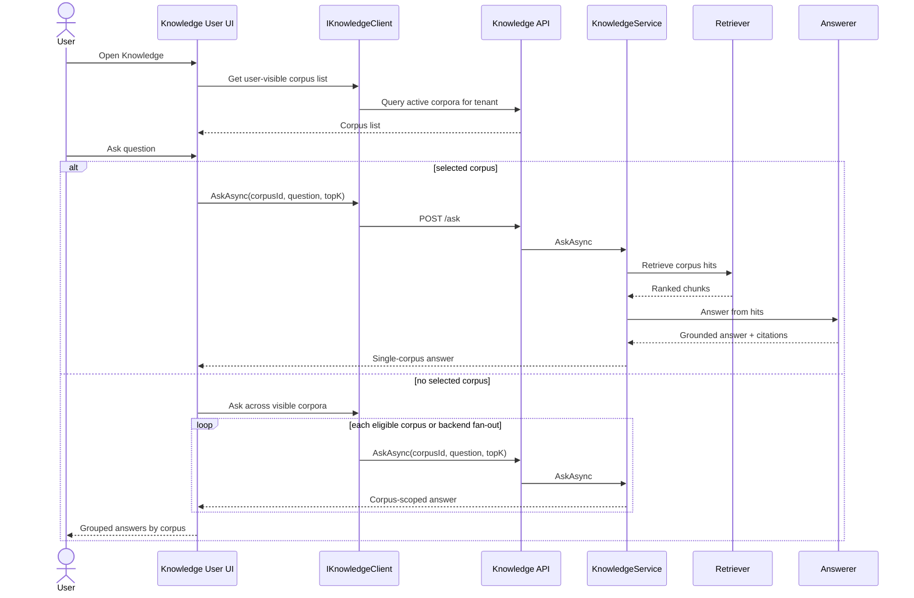
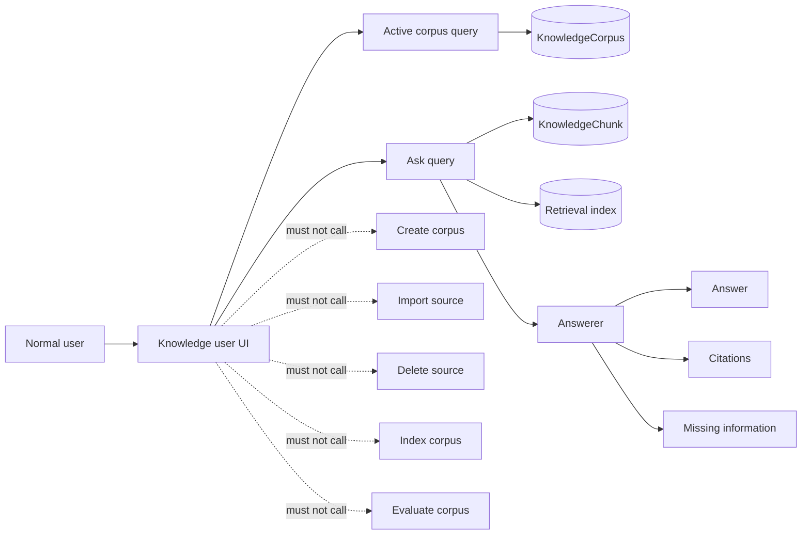

# Knowledge Normal User QA Journey

## 1. Context

- Product / service: Vitarish Knowledge module normal-user question answering
- Journey type: Proposed current-next user query journey
- Entry point: Normal user Knowledge start page, reusing the active tenant and authenticated request context
- User goal: Ask a question against one selected corpus or across all available corpora, then continue with follow-up questions without seeing owner/admin management controls.
- Business goal: Provide a simple read-only Knowledge experience that converts managed corpora into safe, grounded answers for normal users.

## 2. Sketch Interpretation

The hand sketch proposes four connected screens:

1. **Start page**: user sees a corpus list and a central `Ask anything` input.
2. **All-corpus QA**: user asks once and receives grouped answers from multiple corpora/sources.
3. **Selected-corpus QA**: user selects one corpus and asks a new question scoped to that corpus.
4. **Similar/follow-up QA**: user reviews a source-grounded answer, can ask again, or start a new question.

This document keeps that simple flow but separates normal-user read behavior from owner behavior. Normal users do not create corpora, import files, delete sources, index content, or run evaluations.

## 3. Proposed UX Model

| UX area | Proposed behavior |
| --- | --- |
| Corpus list | Shows only active, user-visible corpora for the current tenant. |
| Global input | `Ask anything` starts an all-corpus query when no corpus is selected. |
| Selected corpus | Selecting a corpus scopes the question to that corpus and changes the input hint to `Ask from <corpus>`. |
| All-corpus answer | Shows grouped answer cards by corpus, with best answer first and clear corpus labels. |
| Corpus answer | Shows one focused answer with citations, retrieved context, and missing information if the system cannot answer safely. |
| Follow-up | Follow-up questions keep the selected corpus or selected answer context unless the user explicitly starts a new question. |
| New question | Clears answer state but keeps the corpus selection visible. |
| Ask again | Retries the same question in the same scope; it must not mutate source, chunk, index, or corpus state. |

## 4. Screen Journey Map

## 5. State Model

## 6. Read-Only Query Sequence

## 7. Read Boundary

## Component Coverage Stages

| Stage | Components | User-visible role |
| --- | --- | --- |
| Open normal-user QA | `KnowledgeUserQaSurface`, `KnowledgeChatConversation`, `KnowledgeChatEmptyState` | Present a read-only Knowledge experience with no owner commands. |
| Discover and select corpus scope | `KnowledgeCorpusRail` | Show active corpora and preserve all-corpus versus selected-corpus scope. |
| Compose question | `KnowledgeQuestionComposer`, `KnowledgePromptInput` | Capture the question and submit it in the current read-only scope. |
| Wait for answer | `KnowledgeChatLoader` | Communicate in-flight ask state without changing corpus, source, chunk, or index state. |
| Review answers | `KnowledgeAnswerList`, `KnowledgeAnswerCard`, `KnowledgeChatMessage`, `KnowledgeChatBody` | Display grouped or scoped grounded answers with answer status and missing information. |
| Review citations and context | `KnowledgeChatSourceList`, `KnowledgeChatSource`, `KnowledgeChatCallout` | Keep citations, retrieved context, errors, and missing information visible and corpus-labeled. |

## 8. Happy Path

1. User opens the normal Knowledge page.
2. System loads active corpora available to the user's tenant and permissions.
3. User either asks a global question or selects one corpus first.
4. System retrieves grounded context from the chosen scope.
5. System returns an answer, citations, retrieved context, and missing information when needed.
6. User continues by selecting a corpus, asking a follow-up, retrying the same question, or starting a new question.

## 9. Alternate and Failure Paths

- No visible corpus -> show an empty state: `No knowledge sources are available yet.`
- Empty question -> keep the user on the page and ask for a question.
- Selected corpus becomes unavailable -> clear the selection and reload visible corpora.
- No sufficient grounding -> show a refusal or missing-information result instead of an ungrounded answer.
- Retrieval/answer dependency failure -> show explicit failure and preserve the question so the user can retry.
- All-corpus fan-out partial failure -> show successful corpus answers and mark failed corpus cards as unavailable.

## 10. UX and Guardrail Rules

1. Normal-user Knowledge is read-only.
2. The page must not expose owner commands: create, import, replace, delete, index, or evaluate.
3. All answers must remain corpus-scoped and tenant-scoped.
4. All-corpus mode must still label each answer by corpus; it must not merge citations into an ambiguous source list.
5. Follow-up questions inherit the selected corpus or selected answer context unless the user starts a new question.
6. `Ask again` retries the same question and scope; it must not create new content state.
7. `New question` clears answer state but should not hide the corpus list.

## 11. Acceptance Criteria

- User can see a list of active corpora available to them.
- User can ask without selecting a corpus and receive grouped corpus answers.
- User can select one corpus and ask a scoped question.
- User can continue with follow-up questions in the same selected corpus.
- User can start a new question from the answer screen.
- The answer display includes answer status, answer text, missing information, citations, and retrieved context when available.
- The journey never creates corpus data, imports source content, deletes sources, indexes chunks, or runs evaluation.

## 12. Implementation Notes

- Prefer a separate normal-user surface, for example `KnowledgeUserQaSurface`, rather than reusing owner management components.
- Keep the route separate from owner pages, for example `/knowledge` or `/knowledge/qa`, depending on host navigation policy.
- If all-corpus fan-out is implemented in the UI first, keep the API contract corpus-scoped and call it once per visible corpus.
- If all-corpus fan-out moves backend-side later, introduce a distinct request/response contract so a multi-corpus answer cannot be confused with a single-corpus answer.
- Reuse existing grounded answer display components where possible, but do not reuse owner command components.
