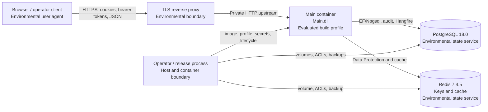

# Evaluated single-machine topology

The three runtime containers share one private network. Only Main is published to the host (`127.0.0.1:5000` in the reference compose file); PostgreSQL and Redis have no host port. A TLS reverse proxy is required for the browser boundary because Main enforces secure cookies and antiforgery. It is environmental and its certificate, listener, upstream, and ACL configuration must be recorded in release evidence.

The evaluated topology has no Web container, agent-runtime, Elasticsearch, MinIO AIStor, SMTP, SMS, AI, Tamin, payment, social, or other provider container.
